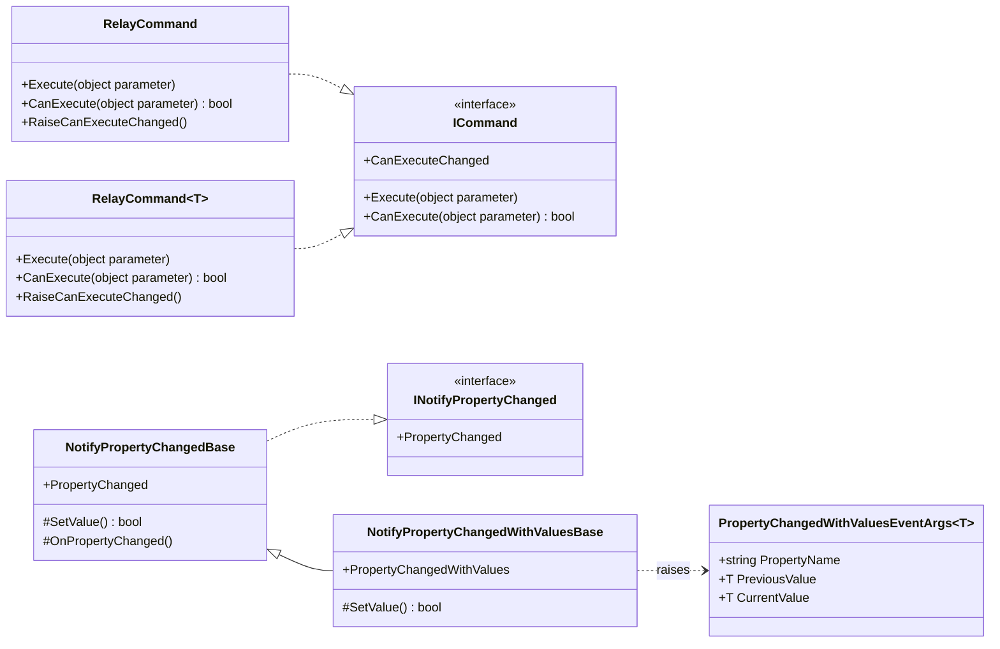

# Infrastructure.Foundation

Core MVVM building blocks for XAML applications: reusable command implementations and
property-change notification bases.

`Infrastructure.Foundation` is a small, dependency-free NuGet package that covers the two mechanics
every view model needs — binding commands to the UI and raising `PropertyChanged` — so that
application projects can focus on business logic instead of re-implementing the same MVVM plumbing.

## About

The package provides:

- a) `ICommand` implementations — an untyped one and a type-safe generic one;
- b) a base class that raises `INotifyPropertyChanged` only when a value actually changes;
- c) an extended base class that also reports the *previous* and the *current* value of a property.

Everything is plain C# with no reference to WPF assemblies: commands are built on
`System.Windows.Input.ICommand`, which is part of the .NET Standard 2.0 contract.

## Features

| Feature | Type | Why it is useful |
| --- | --- | --- |
| Non-generic command | `RelayCommand` | Wraps `Action<object>` / `Func<object, bool>`; accepts any binding parameter. |
| Type-safe command | `RelayCommand<T>` | Works with a strongly typed `Action<T>`; ignores parameters of a mismatched type. |
| Manual requery | `RaiseCanExecuteChanged()` | Re-evaluates `CanExecute` and refreshes the bound control. |
| Change notification | `NotifyPropertyChangedBase` | `SetValue<T>` compares with `EqualityComparer<T>.Default` and notifies only on a real change. |
| Change notification with values | `NotifyPropertyChangedWithValuesBase` | Additionally raises `PropertyChangedWithValues` carrying the old and the new value. |
| Event payload | `PropertyChangedWithValuesEventArgs<T>` | Immutable `PropertyName`, `PreviousValue`, `CurrentValue`. |

## Class Diagram

The whole public surface of the package: two independent groups (commands and bindings),
each built on a BCL interface.



`RelayCommand` is drawn as `RelayCommandNonGeneric` in the source on purpose: Mermaid does not
support two classes with the same name and different generic parameters, so the label carries the
real name.

- `RelayCommand` and `RelayCommand<T>` are unrelated to each other (no shared base class):
  `RaiseCanExecuteChanged()` must be called on the concrete type.
- `SetValue<T>(ref T field, T value, string propertyName)` returns `true` only when the value was
  actually stored; `NotifyPropertyChangedWithValuesBase` overrides it, so `PropertyChangedWithValues`
  exists only in the derived branch.

## Installation

```bash
dotnet add package Infrastructure.Foundation
```

or in the project file:

```xml
<ItemGroup>
  <PackageReference Include="Infrastructure.Foundation" Version="1.0.0" />
</ItemGroup>
```

## How to Use

### 1. Expose commands from a view model

Declare the command with the concrete type (not `ICommand`) when you need to raise
`RaiseCanExecuteChanged()`:

```csharp
using Infrastructure.Foundation.Commands;

public class EditorViewModel
{
    private int _pendingChanges;

    public RelayCommand SaveCommand { get; }

    public EditorViewModel()
    {
        SaveCommand = new RelayCommand(
            execute: _ => Save(),
            canExecute: _ => _pendingChanges > 0);
    }

    public void MarkDirty()
    {
        _pendingChanges++;
        SaveCommand.RaiseCanExecuteChanged();
    }

    private void Save() => _pendingChanges = 0;
}
```

### 2. Prefer the generic command for type safety

```csharp
using System.Windows.Input;
using Infrastructure.Foundation.Commands;

public class EmployeeViewModel
{
    private readonly IEmployeeService _employeeService;

    public ICommand DeleteCommand { get; }

    public EmployeeViewModel(IEmployeeService employeeService)
    {
        _employeeService = employeeService;

        DeleteCommand = new RelayCommand<int>(
            execute: id => _employeeService.Delete(id),
            canExecute: id => id > 0);
    }
}
```

`RelayCommand<T>` never throws on a mismatched parameter: `Execute` does nothing and `CanExecute`
returns `false`. See [Notes and known behaviors](#notes-and-known-behaviors).

### 3. Notify the UI about property changes

```csharp
using Infrastructure.Foundation.Bindings;

public class CounterViewModel : NotifyPropertyChangedBase
{
    private int _count;

    public int Count
    {
        get => _count;
        private set => SetValue(ref _count, value);
    }

    private string _message;

    public string Message
    {
        get => _message;
        set => SetValue(ref _message, value);
    }
}
```

`SetValue<T>` returns `true` when the value was stored and the notification was raised, `false` when
the new value equals the current one. `propertyName` is filled in automatically by
`[CallerMemberName]`; pass it explicitly if you set a field outside the property setter.

### 4. React to a change with the previous and the current value

```csharp
using Infrastructure.Foundation.Bindings;

public class OrderViewModel : NotifyPropertyChangedWithValuesBase
{
    private decimal _total;

    public decimal Total
    {
        get => _total;
        private set => SetValue(ref _total, value);
    }

    public OrderViewModel()
    {
        PropertyChangedWithValues += (_, e) =>
        {
            // e.PropertyName == "Total"; PreviousValue and CurrentValue are boxed as object.
            Console.WriteLine($"{e.PropertyName}: {e.PreviousValue} -> {e.CurrentValue}");
        };
    }
}
```

The extended event is raised **after** the standard `PropertyChanged` event, so data binding is
already updated when subscribers read the new value.

## Main Types

The main types provided by this library are:

- `Infrastructure.Foundation.Commands.RelayCommand`
  *(non-generic `ICommand` implementation over `Action<object>`)*
- `Infrastructure.Foundation.Commands.RelayCommand<T>`
  *(type-safe `ICommand` implementation over `Action<T>`)*
- `Infrastructure.Foundation.Bindings.NotifyPropertyChangedBase`
  *(base class implementing `INotifyPropertyChanged` with `SetValue<T>` helper)*
- `Infrastructure.Foundation.Bindings.NotifyPropertyChangedWithValuesBase`
  *(derived class that also raises `PropertyChangedWithValues`)*
- `Infrastructure.Foundation.Bindings.PropertyChangedWithValuesEventArgs<T>`
  *(event arguments with `PropertyName`, `PreviousValue`, `CurrentValue`)*

## Target Framework & Compatibility

The library targets **.NET Standard 2.0**, so it can be consumed from .NET Framework 4.6.1+,
.NET Core 2.0+, any modern .NET (5+), and Mono/Xamarin runtimes.

`Nullable` and `ImplicitUsings` are disabled in this project, and each file declares its `using`
directives explicitly. The package has **no package dependencies**.

## Notes and known behaviors

- `ArgumentNullException` is thrown from the command constructors when `execute` is `null`.
  A `null` `canExecute` is allowed and means "always executable".
- `RelayCommand<T>.Execute` silently ignores a parameter whose runtime type is not `T`;
  `RelayCommand<T>.CanExecute` returns `false` for such a parameter (and `true` when no
  `canExecute` function was supplied).
- Commands do not hook into `CommandManager.InvalidateRequerySuggested()`. Call
  `RaiseCanExecuteChanged()` yourself when the executability condition changes outside the
  property setter.
- `NotifyPropertyChangedBase` is a class, not an interface: a view model can inherit only one of
  the two base classes.
- `PropertyChangedWithValues` is typed as `EventHandler<PropertyChangedWithValuesEventArgs<object>>`,
  so values arrive boxed; unbox them to the property type before use.
- No marshalling to the UI thread is performed. Raise notifications from the UI thread or dispatch
  in the consuming application.

## Package Details

| Property | Value |
| --- | --- |
| Package ID | `Infrastructure.Foundation` |
| Version | `1.0.0` |
| Target framework | `.NETStandard 2.0` |
| License | MIT |
| Authors | Sukhov A.A. |
| Repository | https://github.com/AntonSukhov/Infrastructure |
| Tags | `mvvm`, `wpf`, `command`, `dotnet` |

## Related Packages

Part of the `Infrastructure` solution. Packages that are commonly used next to this one:

- `Infrastructure.Disposable` — base class for synchronous and asynchronous resource disposal.
- `Infrastructure.Shared` — JSON serialization service, configuration and pagination helpers.
- `Infrastructure.Caching` — generic in-memory cache service.

## Feedback & Contributing

Infrastructure.Foundation is released as open source under the MIT license.
Bug reports and contributions are welcome at the GitHub repository.

## License

© 2026 Sukhov A.A. All rights reserved. Licensed under the MIT license.
