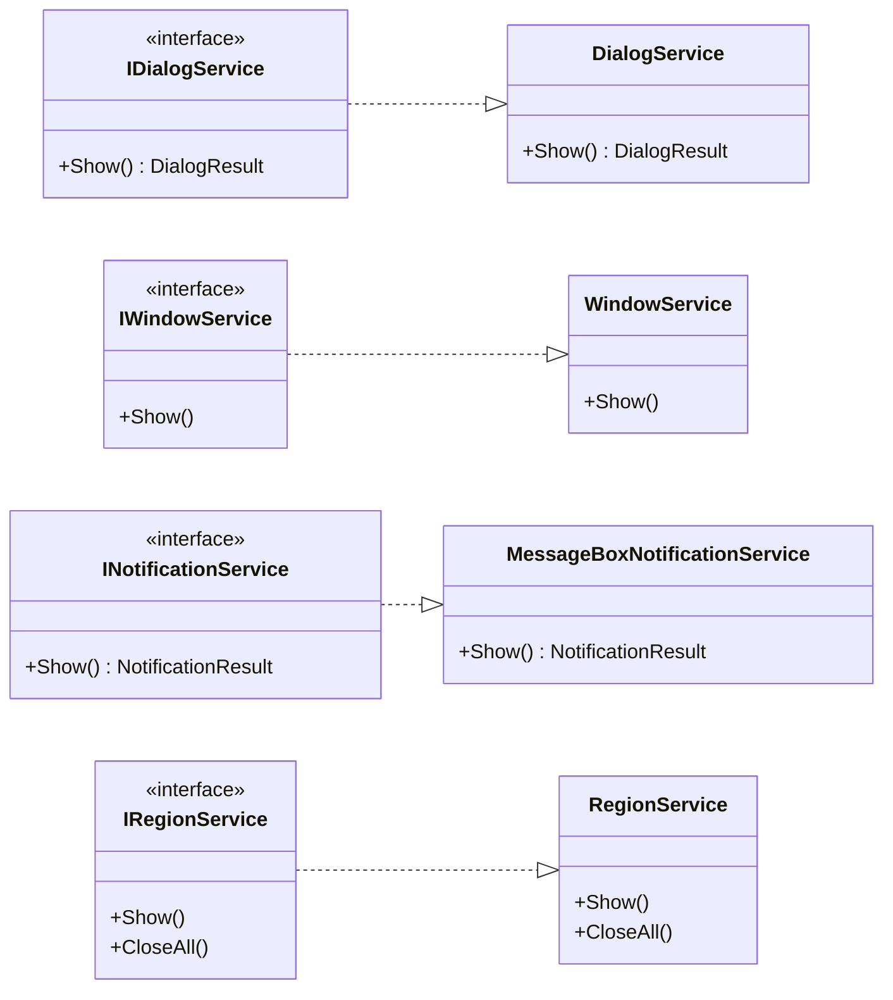
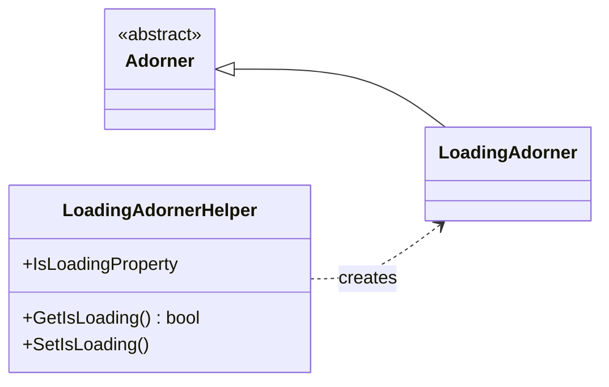

# Infrastructure.Wpf

WPF window management, dialog, notification, and region services for MVVM applications.

`Infrastructure.Wpf` is a small, WPF-specific NuGet package that covers the UI-layer mechanics every
WPF application needs — creating, owning, and disposing of windows; showing dialogs with a result;
sending notifications through `MessageBox`; and managing tab-based regions. A factory-based
configuration pattern keeps the services loosely coupled from view types, so you can wire everything
at composition root and call `Show<TViewModel>()` from any view model.

## About

The package provides:

- a) `IDialogService` / `DialogService` — show a modal dialog backed by a view model and return
  `DialogResult.Confirmed` or `DialogResult.Cancelled`;
- b) `IWindowService` / `WindowService` — show regular (or modal) windows, optionally allowing only
  one instance;
- c) `INotificationService` / `MessageBoxNotificationService` — display a `MessageBox` and return
  a typed result (`NotificationResult`);
- d) `IRegionService` / `RegionService` — manage a `TabControl` as a region of tabbed views,
  adding, switching, and closing tabs;
- e) `LoadingAdorner` / `LoadingAdornerHelper` — show a semi-transparent overlay with a
  progress bar over any `UIElement` via a single attached property (`IsLoading`).

Everything is plain C# targeting .NET Framework 4.8 with `UseWPF`. The package has **no external
NuGet dependencies** — it references only WPF assemblies that ship with the framework.

## Features

| Feature | Type | Why it is useful |
| --- | --- | --- |
| Dialog factory | `DialogConfiguration` | Maps a ViewModel type to a window factory and optional owner factory. |
| Window factory | `WindowConfiguration` | Maps a ViewModel type to a window factory, owner factory, and flags (`IsModal`, `AllowMultipleInstances`). |
| Region item factory | `RegionItemConfiguration` | Maps a ViewModel type to a `UserControl` factory and a tab title. |
| Loading indicator | `LoadingAdornerHelper` | Attached property `IsLoading` that shows/hides a semi-transparent overlay with a progress bar over any `UIElement`. |
| Dialog service | `DialogService` | Resolves the configuration by the runtime type of the view model, sets `DataContext`, shows the dialog, and returns a typed result. |
| Window service | `WindowService` | Resolves configuration, activates an existing window or creates a new one, and shows it (modal or modeless). |
| Notification service | `MessageBoxNotificationService` | Maps WPF `MessageBoxButton` / `MessageBoxImage` / `MessageBoxResult` to domain enums and returns a typed result. |
| Region service | `RegionService` | Adds a `TabItem` with title and close button, activates it, or closes all tabs. |
| Dialog result enum | `DialogResult` | `None`, `Confirmed`, `Cancelled`. |
| Notification button enum | `NotificationButton` | `OK`, `OKCancel`, `YesNo`, `YesNoCancel`. |
| Notification icon enum | `NotificationIcon` | `None`, `Information`, `Warning`, `Error`, `Question`. |
| Notification result enum | `NotificationResult` | `None`, `OK`, `Cancel`, `Yes`, `No`. |

## Class Diagram

The whole public surface of the package: four services, each with an interface and a
concrete implementation. Configuration classes (`DialogConfiguration`, `WindowConfiguration`,
`RegionItemConfiguration`) and domain enums are listed in the [Main Types](#main-types) section.



### Loading indicator



- `IDialogService.Show~TViewModel~(TViewModel viewModel) where TViewModel : class` — shows a modal
  dialog and returns `DialogResult`.
- `IWindowService.Show~TViewModel~(TViewModel viewModel) where TViewModel : class` — shows a regular
  (or modal) window.
- `IRegionService.Show~TViewModel~(TViewModel viewModel) where TViewModel : class` — adds a tabbed
  view to the region; `CloseAll()` removes every tab.
- `INotificationService.Show(string message, string caption, NotificationButton button, NotificationIcon icon)` — shows a `MessageBox` and returns `NotificationResult`.

## Installation

```bash
dotnet add package Infrastructure.Wpf
```

or in the project file:

```xml
<ItemGroup>
  <PackageReference Include="Infrastructure.Wpf" Version="1.1.0" />
</ItemGroup>
```

## How to Use

### 1. Register services and configurations at composition root

Wiring happens once, during application startup, before any view model is created:

```csharp
using System;
using System.Collections.Generic;
using System.Windows;
using Infrastructure.Wpf.Configurations;
using Infrastructure.Wpf.Services.Regions;
using Infrastructure.Wpf.Services.Windows;

// ApplicationWindow / AboutWindow are the application's own views;
// AboutWindowViewModel / WorkUnitsViewModel are its view models.

public partial class App : Application
{
    protected override void OnStartup(StartupEventArgs e)
    {
        base.OnStartup(e);

        var mainWindow = new ApplicationWindow();

        // Window configurations — map ViewModel types to view factories.
        var windowConfigurations = new Dictionary<Type, WindowConfiguration>
        {
            {
                typeof(AboutWindowViewModel),
                new WindowConfiguration
                {
                    OwnerFactory = () => mainWindow,
                    WindowFactory = () => new AboutWindow()
                }
            }
        };

        // Region configurations — map ViewModel types to tab factories.
        var regionConfigurations = new Dictionary<Type, RegionItemConfiguration>
        {
            {
                typeof(WorkUnitsViewModel),
                new RegionItemConfiguration
                {
                    ViewFactory = () => new WorkUnitsView(),
                    Title = "Work units"
                }
            }
        };

        // Create services and assign data context.
        var windowService = new WindowService(windowConfigurations);
        var regionService = new RegionService(mainWindow.ContentTabs, regionConfigurations);

        var viewModel = new ApplicationWindowViewModel(windowService, regionService);
        mainWindow.DataContext = viewModel;
        Current.MainWindow = mainWindow;

        mainWindow.Show();
    }
}
```

`mainWindow.ContentTabs` is the `TabControl` that hosts the region, declared in the shell view:

```xml
<TabControl x:Name="ContentTabs" />
```

### 2. Call services from view models via constructor injection

In the view model, services are injected through the constructor and called from command
execute methods — never instantiated directly:

```csharp
using Infrastructure.Foundation.Commands;
using Infrastructure.Wpf.Services.Regions;
using Infrastructure.Wpf.Services.Windows;

public class ApplicationWindowViewModel
{
    private readonly IWindowService _windowService;
    private readonly IRegionService _regionService;

    public RelayCommand ShowAboutCommand { get; }
    public RelayCommand ShowWorkUnitsCommand { get; }
    public RelayCommand CloseRegionItemsCommand { get; }

    public ApplicationWindowViewModel(IWindowService windowService,
                                      IRegionService regionService)
    {
        _windowService = windowService;
        _regionService = regionService;

        ShowAboutCommand = new RelayCommand(ExecuteShowAbout);
        ShowWorkUnitsCommand = new RelayCommand(ExecuteShowWorkUnits);
        CloseRegionItemsCommand = new RelayCommand(ExecuteCloseRegionItems);
    }

    private void ExecuteShowAbout(object parameter)
    {
        _windowService.Show(new AboutWindowViewModel());
    }

    private void ExecuteShowWorkUnits(object parameter)
    {
        _regionService.Show(new WorkUnitsViewModel());
    }

    private void ExecuteCloseRegionItems(object parameter)
    {
        _regionService.CloseAll();
    }
}
```

The view model holds only the interface types — it is fully testable without the UI. Command
handlers take the `object parameter` required by `RelayCommand`'s `Action<object>` delegate.

### 3. Open a window (modeless or modal, single-instance)

The `WindowService` respects two flags in `WindowConfiguration`:

- `AllowMultipleInstances = false` — the service searches `Application.Current.Windows` for a
  window whose `DataContext` is the target type. If found, it calls `Activate()` instead of
  creating a new window.
- `IsModal = true` — calls `ShowDialog()` instead of `Show()`.

```csharp
var config = new WindowConfiguration
{
    WindowFactory = () => new AboutWindow(),
    AllowMultipleInstances = false,   // reuse existing if present
    IsModal = true                    // modal dialog
};
```

### 4. Send a notification

`MessageBoxNotificationService` is created at composition root and injected into view models
through `INotificationService`:

```csharp
// At composition root:
INotificationService notificationService = new MessageBoxNotificationService();

// In a view model:
var result = notificationService.Show("Record saved.", "Information");

var confirmation = notificationService.Show("Delete the record?", "Confirmation",
    NotificationButton.YesNo, NotificationIcon.Question);

if (confirmation == NotificationResult.Yes)
{
    // delete
}
```

The service maps WPF `MessageBoxButton` / `MessageBoxImage` / `MessageBoxResult` to domain enums
and returns a typed `NotificationResult`.

### 6. Show a loading indicator over any control

`LoadingAdornerHelper` exposes an attached property `IsLoading` that can be bound to a boolean
property on the view model. When the property becomes `true`, a semi-transparent overlay with
a progress bar is placed over the target element; when it returns to `false`, the overlay is
removed. The overlay blocks user interaction with the underlying element, preventing accidental
operations while data is being fetched.

Declare the namespace in XAML:

```xml
<Window x:Class="MyApp.ShellView"
        xmlns="http://schemas.microsoft.com/winfx/2006/xaml/presentation"
        xmlns:x="http://schemas.microsoft.com/winfx/2006/xaml"
        xmlns:interactivity="clr-namespace:Infrastructure.Wpf.Interactivity;assembly=Infrastructure.Wpf">
```

Bind `IsLoading` to any element — for example, wrap the main content area in a `Grid`:

```xml
<Grid>
    <Grid.RowDefinitions>
        <RowDefinition Height="Auto"/>
        <RowDefinition Height="*"/>
        <RowDefinition Height="Auto"/>
    </Grid.RowDefinitions>

    <DataGrid Grid.Row="1"
              ItemsSource="{Binding Employees}"
              interactivity:LoadingAdornerHelper.IsLoading="{Binding IsBusy}"/>
</Grid>
```

In the view model, set the property before and after a long-running operation:

```csharp
using System.ComponentModel;
using System.Runtime.CompilerServices;
using System.Threading.Tasks;
using System.Windows.Input;

public class EmployeesViewModel : INotifyPropertyChanged
{
    private bool _isBusy;
    private readonly IEmployeesRepository _repository;

    public ICommand LoadCommand { get; }

    public EmployeesViewModel(IEmployeesRepository repository)
    {
        _repository = repository;
        LoadCommand = new RelayCommand(async _ => await LoadAsync());
    }

    public bool IsBusy
    {
        get => _isBusy;
        private set => SetProperty(ref _isBusy, value);
    }

    private async Task LoadAsync()
    {
        IsBusy = true;
        try
        {
            Employees = await _repository.GetAllAsync();
        }
        finally
        {
            IsBusy = false;
        }
    }

    public event PropertyChangedEventHandler PropertyChanged;

    private bool SetProperty<T>(ref T field, T value, [CallerMemberName] string name = null)
    {
        if (Equals(field, value)) return false;
        field = value;
        PropertyChanged?.Invoke(this, new PropertyChangedEventArgs(name));
        return true;
    }
}
```

The attached property only works on elements inside an `AdornerLayer` (top-level windows,
`Popup`, or elements inside an `AdornerDecorator`). If `AdornerLayer.GetAdornerLayer`
returns `null`, the property silently does nothing — no error is raised.

## Main Types

The main types provided by this library are:

- `Infrastructure.Wpf.Configurations.DialogConfiguration`
  *(maps a ViewModel type to a dialog window factory and optional owner factory)*
- `Infrastructure.Wpf.Configurations.WindowConfiguration`
  *(maps a ViewModel type to a window factory, owner factory, and `IsModal` / `AllowMultipleInstances` flags)*
- `Infrastructure.Wpf.Configurations.RegionItemConfiguration`
  *(maps a ViewModel type to a `UserControl` factory and a tab title)*
- `Infrastructure.Wpf.Enums.DialogResult`
  *(`None`, `Confirmed`, `Cancelled` — result of a dialog shown through `IDialogService`)*
- `Infrastructure.Wpf.Enums.NotificationButton`
  *(`OK`, `OKCancel`, `YesNo`, `YesNoCancel` — set of buttons in a notification)*
- `Infrastructure.Wpf.Enums.NotificationIcon`
  *(`None`, `Information`, `Warning`, `Error`, `Question` — icon shown in a notification)*
- `Infrastructure.Wpf.Enums.NotificationResult`
  *(`None`, `OK`, `Cancel`, `Yes`, `No` — user's choice in a notification)*
- `Infrastructure.Wpf.Services.Dialogs.IDialogService`
  *(shows a modal dialog with a view model and returns `DialogResult`)*
- `Infrastructure.Wpf.Services.Dialogs.DialogService`
  *(resolves `DialogConfiguration` by the runtime type of the view model, shows the window, and maps `ShowDialog()` result)*
- `Infrastructure.Wpf.Services.Windows.IWindowService`
  *(shows a regular or modal window with a view model)*
- `Infrastructure.Wpf.Services.Windows.WindowService`
  *(resolves `WindowConfiguration`, reuses an existing window if `AllowMultipleInstances` is `false`, and shows it)*
- `Infrastructure.Wpf.Services.Notifications.INotificationService`
  *(shows a `MessageBox`-based notification and returns `NotificationResult`)*
- `Infrastructure.Wpf.Services.Notifications.MessageBoxNotificationService`
  *(maps WPF `MessageBoxButton`, `MessageBoxImage`, `MessageBoxResult` to domain enums)*
- `Infrastructure.Wpf.Services.Regions.IRegionService`
  *(manages a `TabControl` as a region: shows, switches, and closes tabbed views)*
- `Infrastructure.Wpf.Services.Regions.RegionService`
  *(adds `TabItem`s with title and close button; resolves `RegionItemConfiguration` by the static type `TViewModel`)*
- `Infrastructure.Wpf.Interactivity.LoadingAdornerHelper`
  *(attached property `IsLoading` that shows/hides a semi-transparent overlay with a progress bar over any `UIElement`)*
- `Infrastructure.Wpf.Interactivity.LoadingAdorner`
  *(the adorner itself — a semi-transparent panel with centered text and an indeterminate `ProgressBar`)*

## Target Framework & Compatibility

The library targets **.NET Framework 4.8** with WPF (`UseWPF`). It requires Windows and a WPF
runtime; it cannot be consumed from a cross-platform .NET project or a library targeting
`.NETStandard`.

`Nullable` and `ImplicitUsings` are not set in this project (both default to disabled for a
`net48` target), so each file declares its `using` directives explicitly and uses block namespaces.
The package has **no NuGet dependencies** — it references only WPF assemblies that ship with
.NET Framework 4.8 (`PresentationFramework`, `PresentationCore`, `WindowsBase`, `System.Xaml`).

## Notes and known behaviors

- `DialogService` resolves the configuration by the **runtime type** of the argument
  (`viewModel.GetType()`). If the dictionary does not contain an entry for the runtime type,
  `NotSupportedException` is thrown. A `null` `viewModel` throws `ArgumentNullException`.
- `WindowService` resolves the configuration by the **compile-time type** (`typeof(TViewModel)`).
  If the dictionary does not contain an entry, `NotSupportedException` is thrown.
- `RegionService` also resolves by the **compile-time type** (`typeof(TViewModel)`). If no config
  is found, `InvalidOperationException` is thrown. A `null` view model passed to a registered
  config is checked after the view factory runs, so `ArgumentNullException` is thrown with the
  message "viewModel" (after the view is created).
- `WindowService.Show` checks for an existing window by searching `Application.Current.Windows`
  with the pattern `w.DataContext is TViewModel`, so a derived view model also matches. If
  `AllowMultipleInstances` is `false`, the existing window is brought to the foreground via
  `Activate()` and no new window is created.
- `DialogService.Show` maps any non-`true` value of `Window.ShowDialog()` to
  `DialogResult.Cancelled` — `DialogResult.None` is never returned by the service.
- `MessageBoxNotificationService` passes `Application.Current?.MainWindow` as the owner to
  `MessageBox.Show()`. If the application has no main window the message box appears without an
  owner.
- `RegionService` matches an already-open tab by exact type equality
  (`view.DataContext?.GetType() == typeof(TViewModel)`), unlike `WindowService`, which uses
  `is`-semantics. Opening a derived view model type creates a second tab.
- `RegionService.CreateTabItem` adds a close button (`✕`) to each tab header. The button
  executes `RemoveTab` which sets `Template = null` before removing the item from the collection.
- The region service does not expose a `Close(TViewModel)` overload — `CloseAll()` closes every
  tab at once.
- All services expect their configuration dictionaries to be fully populated before the first
  `Show<TViewModel>()` call. Adding entries after the first call works but may lead to inconsistent
  state if the service holds internal references (the current implementation does not cache
  factories).
- No marshalling to the UI thread is performed. Call services from the UI thread or dispatch in the
  consuming application.
- `LoadingAdornerHelper.IsLoading` only works on elements that have an `AdornerLayer` — top-level
  windows, `Popup`, or elements placed inside an `AdornerDecorator`. If `AdornerLayer.GetAdornerLayer`
  returns `null`, the attached property silently does nothing: no overlay is shown and no error
  is raised.
- The overlay blocks user interaction with the adorned element. `LoadingAdorner` paints a
  semi-transparent white `Grid` that intercepts hit-tests, so clicks and keyboard input on the
  underlying control are ignored while `IsLoading` is `true`.
- `LoadingAdornerHelper` prevents duplicate adorners: if `IsLoading` is set to `true` multiple
  times in a row, the existing `LoadingAdorner` is reused rather than creating a new one.
- The default overlay text is `"Загрузка данных..."` (Russian). Pass a custom string to the
  `LoadingAdorner` constructor — the helper currently does not expose a way to set it, so
  applications that need a different text should create a derived helper or set the property
  through a custom attached property.
- No marshalling to the UI thread is performed for `IsLoading` changes. Set the property only
  from the UI thread to avoid `InvalidOperationException`.

## Package Details

| Property | Value |
| --- | --- |
| Package ID | `Infrastructure.Wpf` |
| Version | `1.1.0` |
| Target framework | `.NET Framework 4.8` |
| License | MIT |
| Authors | Sukhov A.A. |
| Repository | https://github.com/AntonSukhov/Infrastructure |
| Tags | `wpf`, `mvvm`, `dialog`, `notification`, `region`, `window`, `tabcontrol`, `loading`, `adorner`, `attached-property` |

## Related Packages

- **Infrastructure.Foundation** — MVVM primitives (`RelayCommand`, `NotifyPropertyChangedBase`),
  typically used together with these WPF services in view models.
- **Infrastructure.Shared** — JSON serialization and configuration helpers, commonly consumed by
  the services that back the dialogs and windows shown through this package.

## Feedback & Contributing

Infrastructure.Wpf is released as open source under the MIT license.
Bug reports and contributions are welcome at the GitHub repository.

## License

© 2026 Sukhov A.A. All rights reserved. Licensed under the MIT license.
